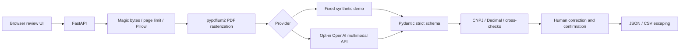

# Architecture

No database, queue, background tasks or durable document storage. A bounded request-body middleware validates full multipart size before parsing; Starlette may spool upload parts to OS temporary disk. Provider-bound images are rebuilt from pixels to drop EXIF/GPS metadata. Live mode explicitly sends the normalized image bytes to an external provider.

Modules: `documents` for bounded input/rasterization; `providers` for replaceable extraction; `schemas` for strict contracts and provenance; `validation` for financial checks; `service` for orchestration; `api` for HTTP/UI/export; `evaluation` for synthetic fixtures.

This is a demonstration, not an accounting system. There is no authentication, persistence, job queue, tenant isolation or production-grade anti-abuse layer.
